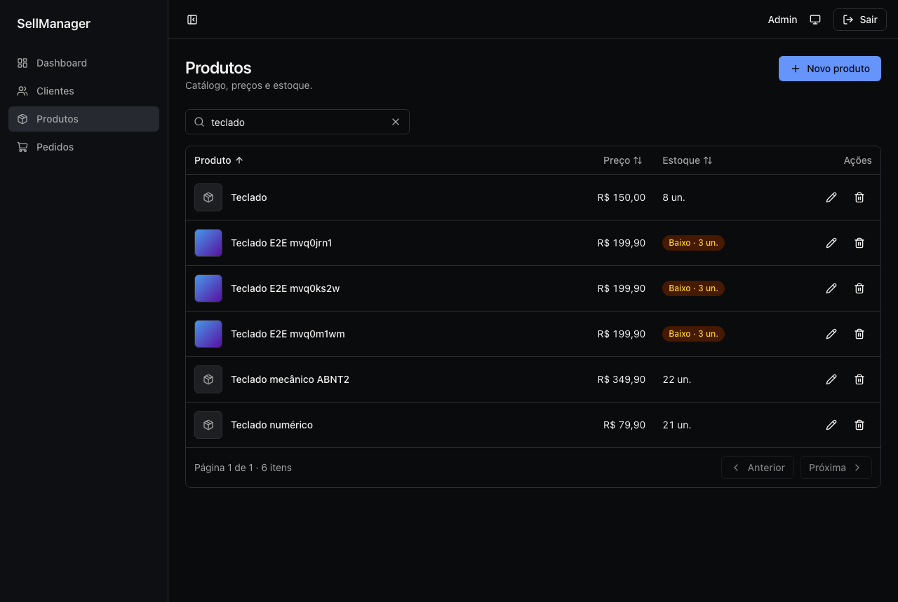
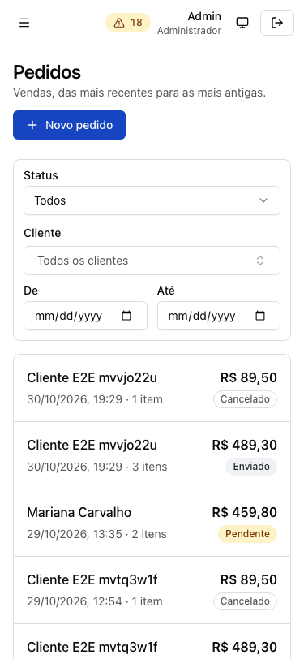
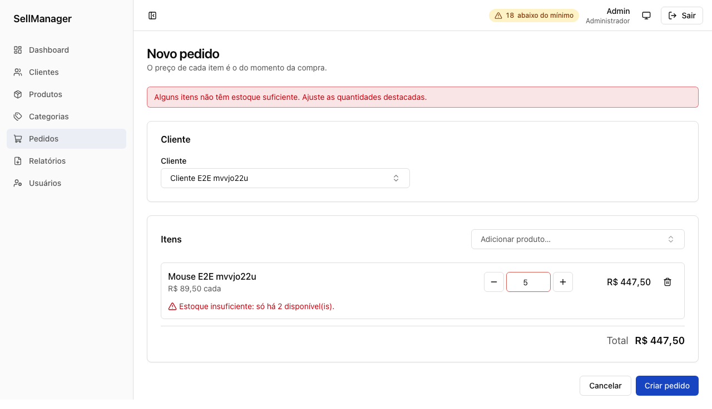
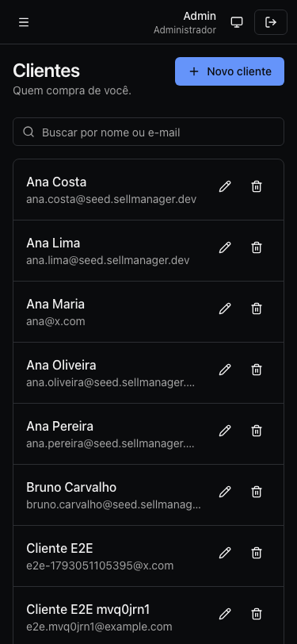

# @sellmanager/web

Front-end do SellManager: React 19 + Vite + TypeScript estrito, com TanStack Router e Query,
react-hook-form com os schemas zod de `@sellmanager/shared`, Tailwind + componentes no estilo
shadcn/ui. Telas: login, dashboard, **clientes**, **produtos** (com imagem) e **pedidos**.

## Como rodar

```bash
docker compose up -d postgres mailpit   # na raiz
pnpm --filter api migration:run
pnpm --filter api seed                  # admin, 30 clientes, 50 produtos, 18 pedidos
pnpm dev                                # api (3333) + web (3000)
```

Abra http://localhost:3000 e entre com `admin@sellmanager.dev` / `admin12345` (criado pelo
seed). Em dev o front chama `/api/...` e o proxy do Vite encaminha para a API (sem CORS).

| Script                                 | O que faz                           |
| -------------------------------------- | ----------------------------------- |
| `pnpm --filter web dev`                | Vite em modo desenvolvimento        |
| `pnpm --filter web build`              | build de produção                   |
| `pnpm --filter web test`               | Vitest + Testing Library + MSW      |
| `pnpm --filter web e2e`                | Playwright contra a API real (seed) |
| `pnpm --filter web lint` / `typecheck` | ESLint (hooks, a11y, camadas) / tsc |

## Telas

Prints gerados pelo Playwright (`pnpm --filter web e2e`) em
[`docs/screenshots/`](docs/screenshots/): 375px e desktop, tema claro e escuro.

| Produtos (desktop, escuro)                                    | Pedidos (375px, claro)                                |
| ------------------------------------------------------------- | ----------------------------------------------------- |
|  |  |

| Erro de estoque apontando a linha                            | Clientes (375px, escuro)                               |
| ------------------------------------------------------------ | ------------------------------------------------------ |
|  |  |

- **Clientes**: lista com busca (debounce) e ordenação por nome, e-mail ou cadastro;
  formulário de criar/editar; detalhe com os pedidos do cliente e atalho para novo pedido;
  exclusão com confirmação que explica a recusa quando há pedidos.
- **Produtos**: lista com miniatura, preço em BRL e selo de estoque (esgotado / baixo ≤ 5);
  formulário com o preço em centavos; imagem com preview, validação de tipo e tamanho
  (os limites do shared), progresso, substituição, remoção e placeholder sem imagem.
- **Pedidos**: lista com cliente, data, itens, total e status, filtrável por cliente e
  período; criação com combobox de cliente e de produtos (busca no servidor), quantidade,
  preço unitário e subtotal por linha, produto repetido somando quantidade, total ao vivo,
  aviso acima do estoque conhecido e o erro de estoque da API apontando a linha; detalhe com
  os preços da compra, concluir e cancelar (devolve o estoque).

### Por que formulário em página (e não em drawer)

O link de `/customers/$id/edit` pode ser compartilhado e sobrevive ao reload; a confirmação de
"alterações não salvas" funciona com o `useBlocker` do router (navegação e fechar a aba); em
375px uma página tem mais espaço que um drawer; e o editor de itens do pedido precisa de
largura de qualquer forma.

### Variáveis de ambiente

Validadas com zod em [`src/lib/env.ts`](src/lib/env.ts); se faltar ou for inválida, o app
falha ao iniciar com uma mensagem clara. Veja [`.env.example`](.env.example).

| Variável           | Descrição                                                  |
| ------------------ | ---------------------------------------------------------- |
| `VITE_API_URL`     | `/api` em dev (proxy) ou a URL absoluta da API em produção |
| `API_PROXY_TARGET` | só dev: destino do proxy (padrão `http://localhost:3333`)  |

## Estrutura e regra de dependência

```
src/
  app/          composition root: Providers, router, App, queryClient
  features/     um diretório por domínio: auth, dashboard, customers, products, orders
  components/   ui/ (base, estilo shadcn), form/, data-table/, combobox/, search/,
                image-upload/, confirm-dialog/, status/, layout/, feedback/
  lib/          api client, tokenStorage, env, formatadores, datas, erros da API, query keys,
                search params de listas, locale do zod, tema
  test/         setup do Vitest, servidor MSW, fixtures tipados, renderApp
e2e/            Playwright: fluxo de venda contra a API real e prints
```

```
app  ->  features  ->  components  ->  lib
```

Camadas internas nunca importam das externas, e uma feature não importa de outra (exceto
`auth`, que é transversal). Isso é **verificado pelo ESLint** (`no-restricted-imports` em
[`eslint.config.mjs`](eslint.config.mjs)). Código usado por duas features sobe para
`components` ou `lib`.

## Contrato único

Nada de tipos ou validações escritos à mão para a API:

- **Tipos e chamadas**: `@sellmanager/api-client` (gerado do `openapi.json`). Mudou o
  contrato, o `typecheck` aponta o que quebrou.
- **Validação de formulários**: os schemas de `@sellmanager/shared`, os mesmos da API.
- **Dinheiro** em centavos inteiros (`*_cents`). Use `MoneyField` e `formatCents`.

## Autenticação

- `POST /sessions` devolve `{ user, token }`. O JWT expira em **2h** (`JWT_EXPIRES_IN` da API).
- **Todo acesso ao token passa por [`src/lib/tokenStorage.ts`](src/lib/tokenStorage.ts)**
  (`get/set/clear`, memória + localStorage). Nenhum outro arquivo toca em localStorage para
  isso; migrar para cookie httpOnly é trocar só essa implementação.
- Recarregar a página **mantém a sessão**: o token persistido é reaproveitado e o usuário é
  buscado em `GET /profile`.
- Fim de sessão (`useAuth().logout`, 401 de requisição autenticada, ou o `exp` do token
  chegando): limpa token e cache, e o router leva a `/login?redirect=<rota de origem>`
  (logout manual vai ao login sem `redirect`). O `exp` lido no front só serve para sair
  cedo; a API continua a fonte de verdade.
- O `redirect` aceita só caminhos internos (`safeRedirect`), contra open redirect.
- Sincroniza login/logout entre abas pelo evento `storage`.

### Segurança

- Sem `dangerouslySetInnerHTML` (React escapa por padrão).
- **CSP** injetada no `index.html` do build ([`vite.config.ts`](vite.config.ts)):
  `script-src 'self'` (sem inline/eval), `connect-src 'self'` + origem da API, `object-src 'none'`,
  `base-uri 'self'`. Em dev ela não é aplicada (o HMR do Vite usa scripts inline). Em
  produção, sirva também por **header HTTP** (`frame-ancestors` só funciona assim).
- O script de tema é um arquivo externo (`public/theme-init.js`) para respeitar a CSP.

### Melhoria planejada: cookie httpOnly + refresh token

Hoje o token fica no localStorage, então um XSS poderia lê-lo. A evolução planejada é a API
emitir um access token curto e um refresh token em cookie `httpOnly; Secure; SameSite`
(com rotação e revogação), de modo que o JavaScript nunca veja o token. Exige tabela de
refresh tokens, `POST /sessions/refresh` e `DELETE /sessions`, CORS com `credentials` e proteção
CSRF (checagem de `Origin`). Foi adiada por ser bem mais código para o escopo atual;
graças ao `tokenStorage` isolado, o front muda pouco.

## Convenções

### Onde colocar uma feature nova

`src/features/<recurso>/` com `queries.ts` (hooks de dados), as páginas/componentes do
domínio e um `index.ts` com o que é público. Depois registre a rota em
[`src/app/router.tsx`](src/app/router.tsx) e o item de menu em
[`AuthenticatedLayout.tsx`](src/app/AuthenticatedLayout.tsx). Veja `features/products` como
modelo.

### Query keys

Sempre por [`lib/queryKeys.ts`](src/lib/queryKeys.ts), no padrão `[recurso, escopo, params]`:
`['products']` (tudo), `['products','list',params]`, `['products','detail',id]`. Para um
recurso novo, adicione-o ao objeto `queryKeys`.

### Criar uma query e uma mutation

Copie [`features/products/queries.ts`](src/features/products/queries.ts) (o modelo comentado):

```ts
export function useProductsList(params: ProductsListParams) {
  return useQuery({
    queryKey: queryKeys.products.list(params),
    queryFn: () =>
      unwrap(
        api.GET('/products', {
          params: { query: { ...params, limit: PAGE_SIZE } },
        }),
      ),
    placeholderData: keepPreviousData,
  });
}

export function useDeleteProduct() {
  const queryClient = useQueryClient();
  return useMutation({
    mutationFn: (id: string) =>
      unwrap(api.DELETE('/products/{id}', { params: { path: { id } } })),
    onSuccess: async () => {
      await queryClient.invalidateQueries({ queryKey: queryKeys.products.all }); // chave RAIZ
      notify.success('Produto excluído.');
    },
  });
}
```

`unwrap` devolve o dado tipado ou lança `ApiClientError`. Erros: `getErrorMessage(error)`
(mapeia o `code` da API para texto amigável, em um só lugar) ou `notify.error(error)`.

**O que cada mutation invalida** (inclua os recursos que exibem o dado alterado):

| Mutation                     | Invalida                                                     |
| ---------------------------- | ------------------------------------------------------------ |
| criar/editar/excluir cliente | `customers` (editar também `orders`, que mostram o nome)     |
| criar/editar produto, imagem | `products` e `orders` (nome do item)                         |
| criar pedido                 | `orders`, `customers.detail(cliente)` e `products` (estoque) |
| concluir/cancelar pedido     | `orders` e `products` (cancelar devolve o estoque)           |

Uma feature não importa outra: o detalhe do cliente busca os pedidos direto da API
(`GET /orders?customer_id=`), e o formulário de pedido tem seus próprios hooks de busca de
clientes e produtos (`useCustomerOptions`, `useProductOptions`).

### Estado da lista na URL

Busca, página e ordenação ficam nos search params tipados da rota, então recarregar ou
compartilhar o link mantém o estado:

```ts
// features/<recurso>/search.ts: campos de ordenação vindos do shared
export const customersSearchSchema = listSearchSchema(CUSTOMER_SORTS);

// router.tsx
createRoute({
  path: '/',
  validateSearch: customersSearchSchema,
  component: CustomersListPage,
});

// na página
const search = route.useSearch(); // { q?, page?, sort?, order? }
navigate({ search: prev => ({ ...prev, q: q || undefined, page: undefined }) });
```

Valores inválidos na URL são ignorados (`.catch`) em vez de quebrar a tela. Use
`SearchInput` (debounce de 300 ms) e passe `sort`/`onSortChange` ao `DataTable`.

### Criar um formulário

```tsx
// MESMO schema da API: nada de regra de validação no front
const form = useZodForm(productBodySchema, { defaultValues: { name: '' } });
const guard = useUnsavedChangesGuard(form.formState.isDirty);

async function save(values: ProductBody) {
  try {
    const created = await create.mutateAsync(values);
    guard.allowNavigation(); // salvou: pode sair sem perguntar
    navigate({
      to: '/products/$productId/edit',
      params: { productId: created.id },
    });
  } catch (error) {
    applyApiError(form, error); // erro de campo da API -> campo; o resto -> alerta geral
  }
}

return (
  <Form form={form} onSubmit={save}>
    <TextField control={form.control} name="name" label="Nome" />
    <MoneyField control={form.control} name="price_cents" label="Preço" />
    <NumberField control={form.control} name="quantity" label="Estoque" />
    <Button type="submit" disabled={form.formState.isSubmitting}>
      Salvar
    </Button>
    {guard.dialog}
  </Form>
);
```

- Campos: `TextField`, `TextareaField`, `NumberField`, `MoneyField` (o valor é em centavos),
  `SelectField`. Para controles próprios (combobox, editor de itens) use `FieldShell`, que liga
  label, descrição e erro com `aria-describedby`.
- As mensagens dos schemas saem em pt-BR por [`lib/zodLocale.ts`](src/lib/zodLocale.ts) (só o
  texto; as regras continuam no shared).
- O botão de enviar fica desabilitado enquanto `isSubmitting`, o que evita duplo submit.

### Componentes reutilizáveis

- `DataTable`: colunas tipadas (`sortKey` torna o cabeçalho ordenável, com `aria-sort`),
  `meta` da API para paginação, `renderCard` para virar lista de cards abaixo de 640px,
  `emptyMessage` + `emptyAction` (chamada para criar o primeiro registro), skeleton e erro com
  "Tentar de novo".
- `Combobox`: busca no servidor (passe `items` e `onSearchChange`); teclado completo (Enter
  abre, setas navegam, Enter escolhe, Esc fecha e devolve o foco).
- `ImageUpload`: valida com `IMAGE_UPLOAD` do shared, preview, progresso (`onUpload(file,
onProgress)`), substituir e remover.
- `ConfirmDialog` e `DeleteDialog` (exclusão que mostra a recusa `RESOURCE_IN_USE` no próprio
  diálogo). `OrderStatusBadge`, `SearchInput`, `PageHeader`.

### Testes

`renderApp('/rota')` monta o app inteiro com router em memória; `signIn()` abre uma sessão
válida; use `server.use(http...)` (MSW) com fixtures de `src/test/fixtures.ts`, que são
tipados pelo contrato. Requisição sem handler **falha** o teste.

**E2E** (`pnpm --filter web e2e`): Playwright contra a API e o banco de dev reais (rode o seed
antes; o Playwright sobe api e web se não estiverem rodando). `e2e/flow.e2e.ts` cria cliente,
produto com imagem e pedido com dois produtos, confere a baixa de estoque, estoura o estoque e
tenta excluir o cliente com pedido. `e2e/screenshots.e2e.ts` gera os prints e falha se alguma
tela tiver rolagem horizontal em 375px.

### Componentes de UI

`components/ui` segue o estilo do shadcn/ui (Radix + Tailwind, código no projeto, sem
dependência de pacote). Para adicionar um, copie o componente do shadcn e ajuste os imports
para `@/lib/utils`.

## Pendências

- O e2e cria dados de teste no banco de dev (nomes com `E2E`) e não os apaga; o seed não os
  remove. Um banco próprio para o e2e resolveria.
- O e2e não roda no CI (precisa de API, banco e navegador); só o Vitest roda.
- CSP como header HTTP no deploy e `frame-ancestors`.
- Cookie httpOnly + refresh token (seção acima).
- Code splitting por rota (o bundle ainda é único: 723 KB, 225 KB com gzip).
- Dockerfile/deploy do web.

## O que eu mudaria na UX

- **Datas**: o `<input type="date">` segue o idioma do navegador (num Chrome em inglês aparece
  `mm/dd/yyyy`). Um date picker próprio em pt-BR, com atalhos ("este mês", "últimos 30 dias"),
  deixaria o filtro de pedidos mais rápido.
- **Imagem na criação**: hoje o produto é salvo e a imagem é enviada na tela de edição. Dá
  para escolher a imagem já no cadastro e enviá-la logo depois do `POST`.
- **Filtro de status** na lista de pedidos (a API ainda não filtra por status) e totais do
  período filtrado.
- **Estoque**: o limite de "estoque baixo" (5) é fixo no front; por produto seria melhor (um
  campo `min_stock` na API).
- **Produto sem estoque** aparece no combobox do pedido (marcado como esgotado); poderia ficar
  desabilitado.
